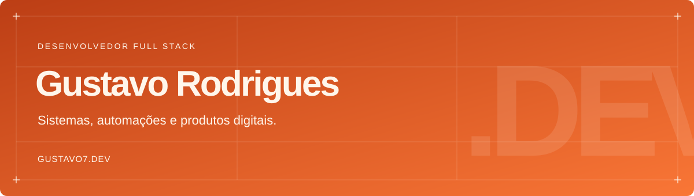

  

  <a href="https://gustavo7.dev">Portfólio</a>
  &nbsp;·&nbsp;
  <a href="https://iasdsync.com">Conheça o iSync</a>
  &nbsp;·&nbsp;
  <a href="mailto:gustavo7.dev@gmail.com">Vamos conversar</a>

## Olá, muito prazer!

Sou o **Gustavo Rodrigues**, desenvolvedor Full Stack. Desde 2021, construo sistemas web e desktop, aplicativos e automações para facilitar o trabalho de quem usa.

Gosto de entender a operação: como uma igreja prepara um culto, como um sacolão atende no caixa, como uma escola organiza as avaliações. É desse contexto que saem os produtos que desenvolvo, da interface e da API à implantação em produção.

Minha fé cristã faz parte de quem sou e orienta a maneira como quero servir às pessoas com meu trabalho.

## O que tenho construído

| Projeto | Para quem e para quê | Conheça |
| --- | --- | --- |
| **iSync · 2026** | Ecossistema para igrejas adventistas: cultos, escalas, repertórios, arquivos e apresentações. Web e desktop, com aplicativo Android nativo conectado à mesma API. | [Conheça o iSync](https://iasdsync.com) |
| **Systemática · 2026** | Calendários avaliativos e fluxos de revisão para a Educação Adventista. Professores preenchem, a coordenação acompanha e as famílias recebem as informações. | [Portal](https://edu.iasdsync.com) |
| **Brotto · 2026** | PDV visual que funciona offline na loja, integrado aos equipamentos do caixa. Painel web para acompanhar vendas e a operação à distância, mesmo fora do estabelecimento. | [Conheça o Brotto](https://usebrotto.com.br) |
| **Carecy · 2025** | Plataforma de acompanhamento médico-paciente, com histórico, formulários e rotinas automáticas de comunicação entre consultas. | [Plataforma](https://institutoparducci.carecy.com.br) |

O **iSync** é o projeto mais especial que desenvolvi até hoje. Nasceu da vontade de modernizar o software usado nas igrejas e apoiar quem serve nelas. Na minha caminhada de fé, acredito que o construí junto com o Espírito Santo.

Também desenvolvo sites institucionais e experiências web para clientes. As capturas de tela e os detalhes dos projetos estão no [meu portfólio](https://gustavo7.dev).

## Tecnologias no meu dia a dia

- **Linguagens:** TypeScript, JavaScript e Kotlin.
- **Web e aplicativos:** React, Next.js, Electron, Jetpack Compose e Tailwind CSS.
- **Backend e dados:** Node.js, Express, Fastify, MongoDB, SQLite, Redis e BullMQ.
- **Integrações e infraestrutura:** WebSocket, Socket.IO, APIs REST, Docker, Linux, Cloudflare, AWS S3 e CI/CD.

Tenho interesse em IA generativa e ferramentas para desenvolvedores. Também contribuí para o projeto open source [Google Gemini CLI](https://github.com/google-gemini/gemini-cli).

## Vamos conversar

Se você tem uma ideia ou um processo que precisa funcionar melhor, podemos começar por uma conversa.

[**gustavo7.dev**](https://gustavo7.dev) · [**gustavo7.dev@gmail.com**](mailto:gustavo7.dev@gmail.com)
